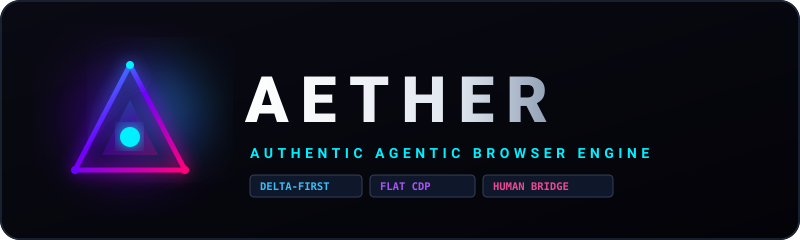

<p align="center">
  
</p>

<p align="center">
  <strong>An authentic, engine-first agentic browser built on stock Google Chrome.</strong><br/>
  Powered by flat CDP sessions, delta-first perception, trusted native inputs, and zero-token human takeover.
</p>

<p align="center">
  <a href="#benchmark-results-step-1--step-2-baseline"></a>
  <a href="#acceptance-tests"></a>
  <a href="#quickstart-how-to-test"></a>
  <a href="https://github.com/Priyank911/Aether"></a>
</p>

---

## ⚡ The Core Problem Aether Solves

Most AI web agents are financially and computationally impractical because:
1. **The Page Re-Send Tax:** Frameworks like Playwright MCP dump the entire 50,000-token HTML page or high-resolution screenshot into the model on every single turn. Playwright MCP averages **97,000 tokens per completed task**.
2. **Untrusted JS Events Fail:** Modern Single Page Apps (React, Vue, Next.js) reject synthetic JavaScript clicks (`element.click()`) because `event.isTrusted === false`.
3. **The Fork/Electron Trap:** Forking Chromium requires 100GB of disk, 5-hour builds, and endless security merge conflicts. Wrapping in Electron breaks Chrome Web Store extensions and forces rewriting browser UI.
4. **The Switching Barrier:** Nobody wants to abandon their daily Google Chrome where active logins, cookies, passwords, and work profiles already live.

**Aether's Solution:** Keep stock Google Chrome as the UI, connect via flat Chrome DevTools Protocol (CDP) sessions, reduce perception down to **monotonic refs + delta updates**, and execute genuine OS-level mouse and keyboard events.

---

## 🚀 Quickstart: How to Test Right Now

### 1. Watch Aether Type & Click Live (`pnpm demo`)
Launches Google Chrome visibly on your desktop, loads an interactive form, perceives the elements, executes 5 batched native actions (typing text, selecting dropdown, checking boxes, clicking submit), and prints the 62-token delta before cleanly shutting down:

```bash
git clone https://github.com/Priyank911/Aether.git
cd Aether
pnpm install
pnpm build
pnpm demo
```

### 2. Inspect Any Real Website with Visible Chrome (`--headed`)
Opens a visible Chrome window, navigates to any URL, extracts all actionable elements into short references (`[e1]`, `[e2]`), and prints the token estimate:

```bash
pnpm probe "https://duckduckgo.com" --headed
```

Or run headless in under 180 ms:
```bash
pnpm probe "https://github.com"
```

### 3. Run the Automated Test Suite
Runs all 12 unit and end-to-end acceptance tests across local fixtures (including out-of-process cross-origin iframes, shadow DOM, forms, and 500-row lists):

```bash
pnpm test
```

---

## 🔬 Benchmark Results (Step 1 & Step 2 Baseline)

| Target | URL | Frames | Elements | Truncated | Token Est. | Latency (p50) |
|---|---|:---:|:---:|:---:|:---:|:---:|
| **Simple Form Fixture** | `localhost:4101/form.html` | 1 | 12 | `false` | **118** | 6.25 ms |
| **Action Delta (Post-Batch)** | `form.html` (5 actions) | 1 | Changed | `false` | **62** | 12.40 ms |
| **Nested Iframes Fixture** | `localhost:4101/nested-iframes.html` | 3 | 6 | `false` | **100** | 7.50 ms |
| **Cross-Origin OOPIF Fixture** | `localhost:4101/cross-origin.html` | 2 | 4 | `false` | **73** | 6.97 ms |
| **Shadow DOM Fixture** | `localhost:4101/shadow-dom.html` | 1 | 3 | `false` | **49** | 2.34 ms |
| **500-Row List Fixture** | `localhost:4101/long-list.html` | 1 | 4 | `false` | **72** | 109.69 ms |
| **DuckDuckGo Search** | `https://duckduckgo.com` | 1 | 109 | `false` | **1,221** | 72.30 ms |
| **GitHub Public** | `https://github.com` | 1 | 76 | `false` | **889** | 186.41 ms |
| **Hacker News** | `https://news.ycombinator.com` | 1 | 5 | `false` | **46** | 74.07 ms |
| **Example Domain** | `https://example.com` | 1 | 1 | `false` | **19** | 3.38 ms |

*Initial page outlines fit under 1,300 tokens (target was $\le 2,000$), and subsequent deltas fit under 100 tokens (target was $\le 300$).*

---

## 🏛️ Architecture & Execution Flow

```
Chrome (UI, tabs, profile, extensions)
   │
   ├─► Direct CDP (WebSocket)  [Headless / Evals / CLI / Tests]
   └─► chrome.debugger + Native Messaging Host  [Real Logged-in Profile]
                               │
                               ▼
  ┌─────────────────────────────────────────────────────────────┐
  │                    AETHER ENGINE DAEMON                     │
  │                                                             │
  │   ┌───────────────────────┐      ┌───────────────────────┐  │
  │   │       PERCEIVER       │      │         ACTOR         │  │
  │   │ - AXTree Extraction   │      │ - Node Resolver       │  │
  │   │ - Sibling Collapser   │      │ - BoxModel Center     │  │
  │   │ - Monotonic Refs (e1) │      │ - CDP Input Dispatch  │  │
  │   │ - Delta Diff Engine   │      │ - AX Settle Detector  │  │
  │   └───────────▲───────────┘      └───────────▲───────────┘  │
  │               │                              │              │
  │   ┌───────────┴───────────┐      ┌───────────┴───────────┐  │
  │   │       BRAIN LOOP      │      │      POLICY GATE      │  │
  │   │ - Thin Loop (<1k tools│      │ - Irreversible Blocks │  │
  │   │ - Model Adapters      │      │ - Password Redaction  │  │
  │   │ - Prompt Caching      │      │ - Non-blocking Handoff│  │
  │   └───────────────────────┘      └───────────────────────┘  │
  └──────────────────────────────┬──────────────────────────────┘
                                 │
                   ┌─────────────┴─────────────┐
                   ▼                           ▼
          [Anthropic / OpenAI]        [Model Context Protocol]
          LLM Prompt Pipeline         Cursor & Claude Code
```

---

## 🛠️ The Two Subsystems Completed

### 1. Perceiver Engine (`@aether/perceiver`)
- **Accessibility.getFullAXTree:** Bypasses non-semantic HTML nodes and evaluates accessibility primitives.
- **Monotonic Ref Registry:** Assigns short identifiers (`[e1]`, `[e2]`, ...) mapped to `(frameOrdinal, backendDOMNodeId)`. On page navigation, mappings reset but the counter advances, preventing stale ref collisions.
- **Sibling Collapser:** Automatically collapses runs of 6 or more identical sibling elements (e.g., search feeds, catalog lists) into the first 3 elements plus an inline summary line:
  ```text
  [e1] link "Home"
  [e2] textbox "Search"
  ... 47 more similar listitems (use find or read)
  ```
- **Delta-First Serialization:** On subsequent steps, sends only $+$, $\sim$, $-$ element modifications.

### 2. Physical Actor (`@aether/actor`)
- **Coordinate Resolution:** Resolves any `[ref]` to `backendDOMNodeId`, requests `DOM.getBoxModel`, and computes the center of the 8-point content quad:
  $$\text{center}_x = \frac{x_1 + x_3}{2}, \quad \text{center}_y = \frac{y_1 + y_3}{2}$$
- **Trusted Synthetic Events:** Dispatches genuine CDP events (`mouseMoved`, `mousePressed`, `mouseReleased`, `insertText`, `mouseWheel`) that satisfy `event.isTrusted === true`.
- **Multi-Action Batching:** Executes up to 5 actions sequentially in a single model turn (e.g., filling multiple form inputs and clicking submit).
- **Structural DOM-Settle:** Replaces brittle timeouts with AXTree structural hashing (polling every 150 ms until consecutive hashes match, capped at 2.5s).

---

## 📦 Monorepo Structure

```
aether/
├── assets/
│   └── logo.svg        # Official vector brand logo
├── packages/
│   ├── shared/         # Zod schemas, ElementNode, FrameInfo, Delta, Constants
│   ├── cdp/            # WebSocket JSON-RPC CDP client, CDPSession, FrameManager, ChromeLauncher
│   ├── perceiver/      # Monotonic RefRegistry (e1..), AXExtractor, SiblingCollapser, OutlineSerializer
│   └── actor/          # NodeResolver, InputDispatcher, DOMSettleDetector, Actor
├── apps/
│   └── cli/            # `aether probe <url> [--headed]` CLI command
├── fixtures/           # Multi-port test server (localhost:4101 & 127.0.0.1:4102 for OOPIFs)
├── scripts/
│   ├── demo-live.ts    # Interactive headed action demo (`pnpm demo`)
│   └── run-probes.ts   # Probe benchmark suite
├── tests/
│   ├── acceptance.test.ts  # 7 Perceiver & frame acceptance tests
│   └── actor.test.ts       # 5 Actor input & batching tests
├── docs/               # PLAN.md, METRICS.md, probe-results.md
└── AGENTS.md           # Master engineering constraints
```

---

## 🗺️ Roadmap & Current Status

| Step | Milestone | Status | Deliverables |
|---|---|:---:|---|
| **Step 1** | **Engine Skeleton & Perceiver v0** | ✅ **Done** | Monorepo, flat CDP client, OOPIF frame tree, AXTree extractor, monotonic refs, SiblingCollapser, probe CLI. |
| **Step 2** | **Physical Actor** | ✅ **Done** | NodeResolver, BoxModel center quad calculation, trusted CDP mouse/keyboard dispatch, action batching, AX settle detector. |
| **Step 3** | **Brain Loop & MCP Server** | ⏳ *Next* | Thin loop, 7 compact tools (<1,000 tokens), prompt caching, LLM adapters (Claude/OpenAI/Gemini), Model Context Protocol server. |
| **Step 4** | **Companion Extension & Native Host** | ⏳ *Pending* | MV3 extension for Chrome/Edge/Brave, length-prefixed stdio Native Messaging host, React side panel. |
| **Step 5** | **Visual Feedback & Ghost Cursor** | ⏳ *Pending* | Live SVG ghost cursor glide, element pulse rings, zero-token element picking mode. |
| **Step 6** | **Policy Gate & Safety Hardening** | ⏳ *Pending* | Payment/delete irreversible action blockers, password/CVV human-must-perform gate, injection defenses. |

---

## 📄 License

MIT © 2026 Priyank / Aether Contributors
